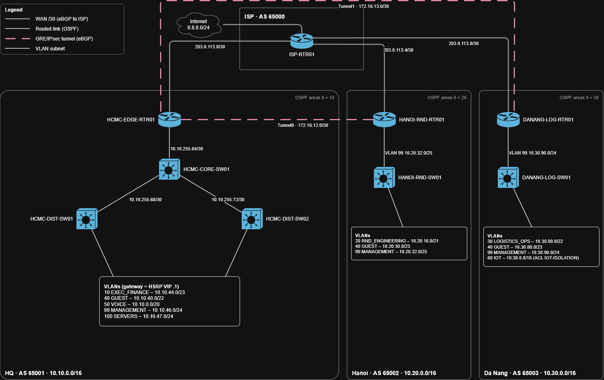
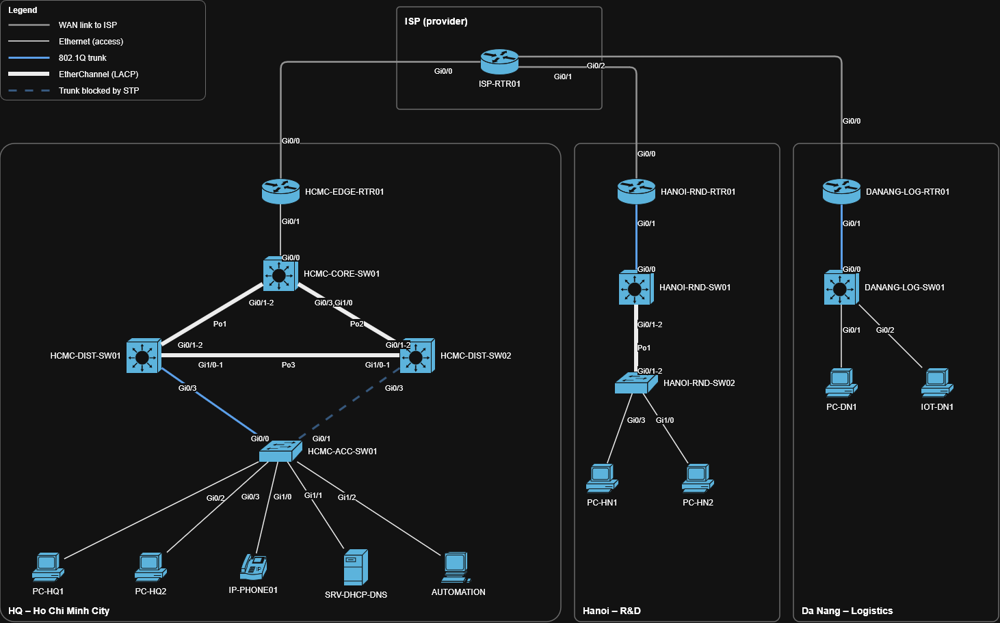

# TechViet Innovations (TVI): Enterprise Network Design & Implementation

[](https://www.gns3.com/)
[](automation/auto_provision.py)
[](evidence/S10_failover.txt)
[](LICENSE)
[-blue)](https://cse.hcmut.edu.vn/)

> **Academic Project — Computer Networks (CO3094), Semester 261**  
> **Faculty of Computer Science and Engineering — Ho Chi Minh City University of Technology (HCMUT - VNU-HCM)**

---

## Overview

This repository contains the end-to-end design, GNS3 lab simulation, device startup configurations, CLI verification evidence, Python/Netmiko automation suite, and technical report for **TechViet Innovations (TVI)** — a multi-site enterprise network spanning three geographical regions in Vietnam plus an upstream ISP:

- **Headquarters (HCMC):** Three-tier campus core, distribution, and access switching supporting `2,000+` users, centralized infrastructure services (`SRV-DHCP-DNS`), and the management automation host.
- **R&D & Engineering Campus (Hanoi):** High-capacity branch campus supporting `1,500+` engineers via router-on-a-stick and redundant LACP switching.
- **Logistics & Distribution Hub (Da Nang):** Branch hub supporting `500+` operations staff and `10,000+` reserved IoT endpoints behind dedicated isolation policies.
- **21-Node GNS3 Emulation:** Built with `5` Cisco vIOS routers, `7` Cisco vIOS-L2 switches, `7` VPCS endpoints, `1` Docker automation controller, and `1` GNS3 NAT cloud.

---

## Network Architecture & Topologies

### Site & Autonomous System Summary

| Site | Role | BGP AS | IPv4 Block | IPv6 Block | Underlay IGP |
| --- | --- | --- | --- | --- | --- |
| **ISP** (`ISP-RTR01`) | Simulated upstream provider & Internet (`8.8.8.0/24`) | `65000` | `203.0.113.0/24` | `2001:db8:ffff::/48` | Static / eBGP |
| **HQ — Ho Chi Minh City** | Three-tier campus, centralized DHCP/DNS, IPsec hub | `65001` | `10.10.0.0/16` | `2001:db8:10::/48` | OSPFv2 Areas `0` & `10` |
| **R&D — Hanoi** | Engineering campus, IPsec spoke, local Internet breakout | `65002` | `10.20.0.0/16` | `2001:db8:20::/48` | OSPFv2 Areas `0` & `20` |
| **Logistics — Da Nang** | Warehouse & IoT hub, IPsec spoke, local Internet breakout | `65003` | `10.30.0.0/16` | `2001:db8:30::/48` | OSPFv2 Areas `0` & `30` |

### Logical Topology



### Physical Topology



Editable Draw.io diagrams, the Python topology generator, and the complete VLSM/IPv6 addressing plan are located in [`docs/topology/TVI-Topology.drawio`](docs/topology/TVI-Topology.drawio), [`docs/topology/make_topology.py`](docs/topology/make_topology.py), [`docs/design/TVI-IP-Schema.md`](docs/design/TVI-IP-Schema.md), and [`docs/design/TVI-Plan-v1.2.md`](docs/design/TVI-Plan-v1.2.md).

---

## Key Features

### Campus LAN & Layer 2/3 High Availability
- **Three-Tier HQ Campus:** Separates WAN edge (`HCMC-EDGE-RTR01`), Layer 3 core (`HCMC-CORE-SW01`), dual distribution (`HCMC-DIST-SW01/02`), and access (`HCMC-ACC-SW01`) layers.
- **VLANs & Port Isolation:** Dedicated departmental VLANs (`10 EXEC_FINANCE`, `20 RND_ENGINEERING`, `30 LOGISTICS_OPS`, `40 GUEST`, `50 VOICE`, `60 IOT`, `99 MANAGEMENT`, `100 SERVERS`) with unused ports shut down and parked in `VLAN 999` (`BLACKHOLE`).
- **Loop Prevention & Link Aggregation:** Rapid-PVST+ (`802.1w`) with deterministic root bridges (`HCMC-DIST-SW01` primary priority `24576`, `DIST-SW02` secondary `28672`, `CORE` root for transit VLANs `900–902`) and active LACP EtherChannels (`Po1`, `Po2`, `Po3`, and Hanoi `Po1`).
- **Gateway Redundancy:** HSRP v2 on all HQ distribution SVIs (`priority 110`, `preempt`, `Port-channel1` uplink tracking with decrement `20`).
- **Centralized IP Services:** `SRV-DHCP-DNS` (`10.10.47.10`) serves HQ DHCP pools, `srv.tvi.lab` DNS resolution, NTP, and Syslog; `HCMC-EDGE-RTR01` hosts branch DHCP pools reached via `ip helper-address` across the encrypted tunnels.

### Routing, WAN Overlay & IPv6 Dual-Stack
- **Multi-Area OSPFv2 Underlay:** Site-local OSPF with `passive-interface default`, `Loopback0` router IDs, and ABR summarization (`10.10.0.0/18` at `HCMC-CORE-SW01`).
- **eBGP & GRE/IPsec Overlay:** `eBGP` peering with `ISP-RTR01` filtered by `PUBLIC-ONLY` (preventing `RFC 1918` leaks), paired with GRE over IPsec tunnels (`Tunnel0` `172.16.12.0/30` and `Tunnel1` `172.16.13.0/30`, IKEv1 PSK, AES-256, SHA-256, DH Group 14) advertising single `/16` site summaries via `INTERNAL` prefix-lists.
- **Local Internet Breakout:** Each branch maintains a local default route and PAT directly to the ISP, avoiding HQ backhaul latency.
- **IPv4/IPv6 Dual-Stack:** Hierarchical `2001:db8:SITE:VLAN::/64` addressing deployed alongside IPv4 on all Layer 3 interfaces with SLAAC for internal hosts.

### Security, QoS & Network Automation
- **Segmentation & NAT:** Inbound ACLs `GUEST-IN` (Internet + DNS/DHCP only, internal `10.0.0.0/8` blocked) and `IOT-ISOLATION` (permits `10.30.0.0/18` to `10.10.47.10` and Internet only), PAT Overload on every site edge router, plus Static NAT HTTPS forwarding (`203.0.113.2:8443 -> 10.10.47.10:443`) on `HCMC-EDGE-RTR01`.
- **Switch & Control-Plane Hardening:** DHCP Snooping on `HCMC-ACC-SW01` (`VLANs 10, 40, 50`), SSHv2-only remote access, local AAA, `service password-encryption`, and HTTP/Telnet disabled on infrastructure nodes.
- **Quality of Service (QoS):** Ingress DSCP classification (`MARK-IN`: Voice `10.10.0.0/20 -> EF`, Video `UDP 3478–3481 -> AF31`, plus branch return-path marking) and hierarchical WAN egress shaping (`10 Mbps` parent shaper with LLQ `30%` priority for `DSCP EF` and `25%` bandwidth for `AF31`).
- **Idempotent Python Automation:** [`automation/auto_provision.py`](automation/auto_provision.py) reads [`automation/inventory.yaml`](automation/inventory.yaml) and `TVI_USER`/`TVI_PASS` (or `getpass` — zero hardcoded credentials), saves ISO 8601 before/after backups, pushes only missing baseline/VLAN commands, and catches per-device SSH timeouts without aborting the batch.

---

## 1. Prerequisites & GNS3 Setup

**Recommended Host:** Windows 10/11, CPU with Intel VT-x / AMD-V, 24 GB+ host RAM (16 GB allocated to GNS3 VM), VMware Workstation.

1. Disable **Memory Integrity** (Windows Security → Device security → Core isolation) and Hyper-V/VBS (`bcdedit /set {current} hypervisorlaunchtype off` & `vsmlaunchtype off`) so VMware nested virtualization is active.
2. Install **GNS3 2.2.61** and the matching **GNS3 VM 2.2.61** `.ova` in VMware with **Virtualize Intel VT-x/EPT** checked, **8 vCPUs**, and **16,384 MB RAM** (`KVM support available: True`).
3. Import the required images into GNS3 preferences (not included in this repository due to licensing) using the exact template names below:

| GNS3 Template | Image / Package | Settings |
| --- | --- | --- |
| `vIOS` | `vios-adventerprisek9-m.vmdk.SPA.156-2.T` + `IOSv_startup_config.img` | QEMU, `virtio`, `512 MB` RAM, `4` adapters |
| `vIOS-L2` | `vios_l2-adventerprisek9-m.vmdk.SSA.152-4.0.55.E` | QEMU, **IDE disk** (`virtio` crashes on boot), `1024 MB` RAM, `8` adapters |
| `AUTOMATION` | Docker `adosztal/network_automation` | `2` adapters (`eth0` = VLAN 99, `eth1` = NAT) |
| `PC-*`, `IP-PHONE01`, `IOT-DN1` | Built-in `VPCS` | Default |

---

## 2. Opening & Running the Lab

1. Start GNS3 and wait for the **GNS3 VM** indicator to turn green.
2. Open [`gns3/TVI.gns3`](gns3/TVI.gns3) via **File → Open project** (or import a portable `.gns3project` if transferring between hosts).
3. Click **Start all nodes** and wait ~5 minutes for all Cisco images to boot.
4. On `HCMC-EDGE-RTR01`, verify BGP convergence with `show ip bgp summary` (`172.16.12.2`, `172.16.13.2`, and `203.0.113.1` should show received prefixes).
5. On the VPCS hosts (`PC-HQ1`, `PC-HQ2`, `IP-PHONE01`, `PC-HN1`, `PC-HN2`, `PC-DN1`), run `ip dhcp` to acquire leases (`IOT-DN1` uses static `10.30.0.10/18`).

> For the complete Vietnamese startup checklist, 15-minute live demo script, and shutdown steps, see [`docs/design/DEMO-GUIDE.md`](docs/design/DEMO-GUIDE.md).

---

## 3. Network Automation

Run the provisioning and backup script from the `AUTOMATION` container (or a host with `netmiko` and `pyyaml` installed):

```bash
cd /root/Automation   # or ./automation locally
export TVI_USER=admin
read -s TVI_PASS && export TVI_PASS
python3 auto_provision.py                  # provision/audit all 10 managed devices
python3 auto_provision.py HCMC-ACC-SW01    # target specific hostnames
```

- Repeated runs on compliant devices log `no changes` without running `write memory`.
- If a node is offline, `NetmikoTimeoutException` is logged to [`automation/logs/automation.log`](automation/logs/automation.log) and execution continues for the remaining devices.
- See [`automation/README.md`](automation/README.md) for full usage details.

---

## 4. Verification, Failover & Evidence

All 10 rubric phases have been verified in GNS3, with raw CLI captures stored in [`evidence/`](evidence/) and compiled into the final report [`docs/report/CO3094_Assignment2_CC02_Group7.pdf`](docs/report/CO3094_Assignment2_CC02_Group7.pdf):

| Phase | Verified Capabilities | Key Evidence Files |
| --- | --- | --- |
| **Steps 1–2** | 3-site Physical/Logical topology & VLSM/IPv6 schema | [`TVI-Topology.drawio`](docs/topology/TVI-Topology.drawio), [`TVI-IP-Schema.md`](docs/design/TVI-IP-Schema.md) |
| **Step 3** | VLANs, 802.1Q trunks, LACP `Po1`/`Po2`/`Po3`, Rapid-PVST+ root & `BLK` state | [`S3_ACC_vlan_trunk.txt`](evidence/S3_ACC_vlan_trunk.txt), [`S3_CORE_etherchannel.txt`](evidence/S3_CORE_etherchannel.txt), [`S3_DIST2_stp.txt`](evidence/S3_DIST2_stp.txt) |
| **Step 4** | HSRP active/standby, centralized DHCP across IPsec tunnels, DNS `srv.tvi.lab` | [`S4_DIST1_standby.txt`](evidence/S4_DIST1_standby.txt), [`S4_PC-HN1_dhcp.txt`](evidence/S4_PC-HN1_dhcp.txt), [`S4_HN-RTR_dns.txt`](evidence/S4_HN-RTR_dns.txt) |
| **Step 5** | Multi-area OSPFv2 ABR summarization, loopback reachability, IPv6 GUA + SLAAC | [`S5_CORE_ospf.txt`](evidence/S5_CORE_ospf.txt), [`S5_EDGE_ospf_interarea.txt`](evidence/S5_EDGE_ospf_interarea.txt), [`S5_PC-HQ1_ipv6.txt`](evidence/S5_PC-HQ1_ipv6.txt) |
| **Step 6** | ISP & overlay eBGP `/16` summaries, `PUBLIC-ONLY` filter, GRE/IPsec `QM_IDLE` | [`S6_EDGE_bgp.txt`](evidence/S6_EDGE_bgp.txt), [`S6_ISP_bgp.txt`](evidence/S6_ISP_bgp.txt), [`S6_EDGE_crypto.txt`](evidence/S6_EDGE_crypto.txt) |
| **Step 7** | `GUEST-IN` & `IOT-ISOLATION` ACLs, PAT + Static NAT `:8443`, DHCP Snooping, SSHv2 | [`S7_PC-HQ2_guest.txt`](evidence/S7_PC-HQ2_guest.txt), [`S7_IOT-DN1_isolation.txt`](evidence/S7_IOT-DN1_isolation.txt), [`S7_EDGE_nat.txt`](evidence/S7_EDGE_nat.txt), [`S7_ACC_dhcp_snooping.txt`](evidence/S7_ACC_dhcp_snooping.txt) |
| **Step 8** | Voice `DSCP EF` / Video `AF31` ingress marking & WAN egress LLQ priority queue | [`S8_EDGE_qos.txt`](evidence/S8_EDGE_qos.txt), [`S8_HN_qos.txt`](evidence/S8_HN_qos.txt) |
| **Step 9** | Idempotent provisioning, timeout error handling, ISO 8601 config backups | [`S9_ACC_baseline.txt`](evidence/S9_ACC_baseline.txt), [`S9_automation.log`](evidence/S9_automation.log) |
| **Step 10** | Inter-site tunnel path, local Internet exit, core uplink failover (**0/150 lost**) | [`S10_PC-HQ1_to_branches.txt`](evidence/S10_PC-HQ1_to_branches.txt), [`S10_PC-DN1_internet.txt`](evidence/S10_PC-DN1_internet.txt), [`S10_failover.txt`](evidence/S10_failover.txt) |

---

## 5. Project Layout

```text
enterprise-network-design/
├── automation/
│   ├── backups/                                  # Timestamped running-config & interface backups
│   ├── logs/                                     # Automation execution logs (automation.log)
│   ├── auto_provision.py                         # Idempotent Netmiko baseline & VLAN provisioner
│   ├── inventory.yaml                            # External device management IPs & VLAN payloads
│   └── README.md                                 # Automation setup & execution guide
├── configurations/
│   ├── HQ_Startup_Configs/                       # Exported startup configs for HCMC nodes & server
│   ├── Hanoi_Startup_Configs/                    # Exported startup configs for Hanoi R&D nodes
│   ├── DaNang_Startup_Configs/                   # Exported startup configs for Da Nang Logistics nodes
│   └── ISP_Config/                               # Exported startup config for ISP-RTR01
├── docs/
│   ├── design/
│   │   ├── DEMO-GUIDE.md                         # Vietnamese GNS3 startup & 15-min live demo runbook
│   │   ├── TVI-IP-Schema.md                      # VLSM IPv4, IPv6 /48->/64, and summarization tables
│   │   └── TVI-Plan-v1.2.md                      # Master design plan, image notes & rubric mapping
│   ├── report/
│   │   └── CO3094_Assignment2_CC02_Group7.pdf    # Final technical explanation report
│   ├── specs/                                    # Course assignment brief and NAT reference guide
│   └── topology/
│       ├── make_topology.py                      # Script generating the 2-page Draw.io topology
│       ├── TVI-Logical.png                       # Exported Logical L3/routing topology diagram
│       ├── TVI-Physical.png                      # Exported Physical L1/L2/interface topology diagram
│       └── TVI-Topology.drawio                   # Source Draw.io file (Physical + Logical pages)
├── evidence/                                     # Raw CLI verification logs for Steps 3–10
├── gns3/
│   └── TVI.gns3                                  # GNS3 21-node project topology file
├── .gitignore
├── LICENSE                                       # MIT License
└── README.md                                     # Project documentation
```

---

## 6. Contributors

**Computer Networks (CO3094) — Assignment 2 (Group 7, Class CC02)**  
Faculty of Computer Science and Engineering, HCMUT - VNU-HCM.

- **Pham Vu Khoi Nguyen** ([@nguyenpham143](https://github.com/nguyenpham143) – Student ID: `2412372`)
- **Le Tran Minh Phuong** (Student ID: `2453025`)
- **Huynh Gia Bao** (Student ID: `2452121`)
- **Vu Huy Hoang** (Student ID: `2452364`)

---

## 7. License

This project is licensed under the [MIT License](LICENSE) — Copyright (c) 2026 nguyenpham143.
